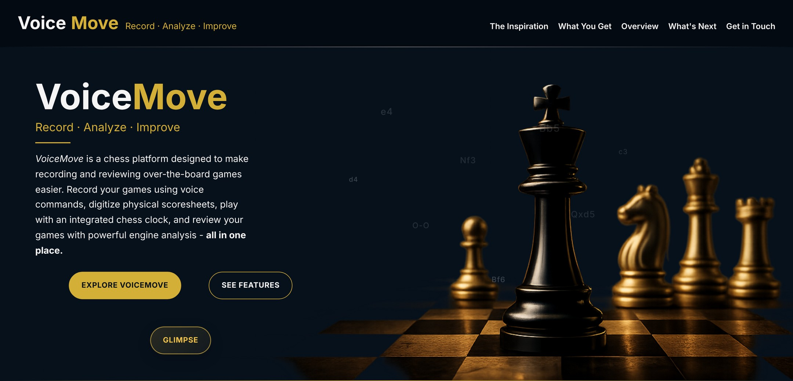
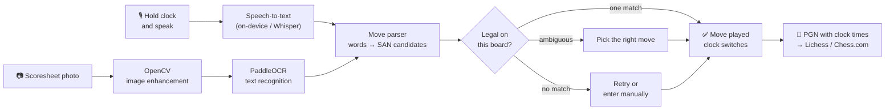

<div align="center">

# ♞ VoiceMove

### Record · Analyze · Improve

**Speak your chess moves instead of writing them down.**
VoiceMove is a voice-controlled chess clock, scoresheet reader and game recorder for over-the-board players.

[**Live website**](https://ab-thecoder.github.io/Voice_move/) &nbsp;·&nbsp;
[**Try the browser demo**](https://ab-thecoder.github.io/Voice_move/Voice_Move.html) &nbsp;·&nbsp;
[**Run the app**](#3-run-the-flutter-app-vccn)


</div>



---

## Table of contents

- [The spark](#the-spark)
- [What VoiceMove does](#what-voicemove-does)
- [How it works](#how-it-works)
- [Project status](#project-status)
- [Try it yourself](#try-it-yourself)
- [Project structure](#project-structure)
- [Tech stack](#tech-stack)
- [Challenges and open questions](#challenges-and-open-questions)
- [Team](#team)
- [AI usage](#ai-usage)
- [Contact](#contact)

---

## The spark

Chess is an analytical, ever-learning game. Just like in life, getting better at chess means looking back at your mistakes and learning from them, and for an over-the-board game that means reviewing it afterwards.

While analysing a friendly game together, we realised how annoying and inefficient it was to type every move from a paper scoresheet into an analysis board. Writing moves down during the game, digitising the sheet afterwards, then setting the whole game up again just to look at it: it all took far longer than it should.

**And that was that.** We decided to throw that workflow in the bin and build something better:

- **Speak** your move while you press your clock, instead of writing it down.
- **Photograph** an existing paper scoresheet and turn it into a digital game.
- **Export** a clean PGN (with clock times) straight into Lichess, Chess.com or any analysis tool.

## What VoiceMove does

VoiceMove has three parts that share the same idea.

### 📱 The app: VCCN (Voice-Controlled Chess Notation), built in Flutter

A full-screen two-player chess clock that records the game as you play.

| Feature | Details |
|---|---|
| **Press-and-hold voice moves** | Tap your clock to switch sides as normal. **Hold** it to speak your move ("knight f3", "e takes d5", "castles kingside"...). Speech is recognised on-device. |
| **Spoken-move parser** | A custom `MoveParser` turns natural speech into chess moves, handling piece names, files, ranks, captures, castling, promotions and common mis-hearings. |
| **Legal-move validation** | Every move is checked against the real board position with `dartchess`. If a phrase could mean more than one legal move, you choose the right one. |
| **Undo and recovery** | A quick undo after each move, and a "Move not detected" screen that lets you retry or enter the move by hand. |
| **Manual move picker** | Tap a piece icon to highlight those pieces, pick one, and tap a highlighted legal square to play it. |
| **Time controls** | Presets from 1 min to 30 min, including increment modes (2\|1, 3\|2, 5\|3, 15\|10), plus pause and resume. |
| **Automatic game end** | Detects checkmate, stalemate, insufficient material, the 50-move rule and threefold repetition. |
| **PGN export** | Shares a PGN with headers, the time control and `[%clk]` clock times for every move, so it imports straight into Lichess or Chess.com. |

### 🌐 The website (GitHub Pages)

- **[Landing page](https://ab-thecoder.github.io/Voice_move/):** the story, features and roadmap of VoiceMove.
- **[Glimpse demo](https://ab-thecoder.github.io/Voice_move/Voice_Move.html):** a working chess clock in the browser. Tap to switch, hold your clock to speak a move (Web Speech API), add moves on a mini board, upload a scoresheet photo (OCR hookup coming soon), and copy the game as PGN.

### 🐍 The Python backend (research and prototypes)

- **Voice pipeline** (`App/backend/current/Voice_MOve.py`): records audio → transcribes it with **OpenAI Whisper** → cleans the text into move candidates with regex post-processing → validates them with **python-chess** → builds and saves a `.pgn` file. If speech fails, you can type the move instead.
- **Scoresheet OCR** (`App/backend/current/paddle2x.py`): enhances a photo of a handwritten or printed scoresheet with **OpenCV** (grayscale, upscaling, deskewing, contrast clean-up) and then reads the moves with **PaddleOCR**.
- **Terminal chess clock** (`App/backend/current/clock.py`): a keyboard-driven clock with increment, pause/resume and flag detection.

## How it works



## Project status

| Part | Status |
|---|---|
| Voice notation | ✅ Completed |
| Scoresheet OCR | ✅ Completed (Python prototype) |
| Chess clock | ✅ Completed |
| Engine analysis | 🚧 In progress |
| Connecting the app/website to the Python backend (FastAPI) | 🗺️ Planned |
| Chess Academy System, so coaches can follow and review their students' games | 🔜 Coming soon |

Our goal is to make every game more than just a game, and to turn it into an opportunity to learn.

## Try it yourself

### 1. Use the website (no install)

Open the **[Glimpse demo](https://ab-thecoder.github.io/Voice_move/Voice_Move.html)**, tap a clock to start, then **press and hold** your clock and say a move.

> Voice input uses the browser's Web Speech API, so use **Chrome, Edge or Safari** (Firefox doesn't support it) and allow microphone access when asked.

### 2. Run the website locally

```bash
git clone https://github.com/AB-TheCoder/Voice_move.git
cd Voice_move/docs
python -m http.server 8000
# open http://localhost:8000
```

### 3. Run the Flutter app (VCCN)

**Install Flutter (includes Dart).** This is a one-time setup for anyone demoing the app, including reviewers.

1. **Download the Flutter SDK** from <https://docs.flutter.dev/get-started/install> and choose your OS (Windows, macOS or Linux). The Dart SDK comes with it, so there's no separate Dart install.
2. **Add Flutter to your PATH.**
   - macOS/Linux (if you extracted it to `~/development/flutter`):
     ```bash
     export PATH="$PATH:$HOME/development/flutter/bin"
     ```
     Add that line to `~/.zshrc` or `~/.bashrc` so it persists.
   - Windows: add the full path of the `flutter\bin` folder to **System Environment Variables → Path**.
3. **Check the install:**
   ```bash
   flutter doctor
   ```
   It tells you if anything else is missing, such as Android Studio, Xcode, or a connected device or emulator.

**Get the code and run it:**

```bash
git clone https://github.com/AB-TheCoder/Voice_move.git
cd Voice_move/flutter_projects/vccn_app
flutter pub get
flutter run
```

`flutter run` asks you to pick a device if more than one is available (Android phone/emulator, iOS simulator, macOS, etc.).

<details>
<summary><b>Running and demoing the macOS desktop build</b></summary>

For local testing, or to show a reviewer the app working, the Flutter prototype can run as a native macOS desktop app instead of only on Android or iOS.

1. Enable macOS as a build target (one-time):
   ```bash
   flutter config --enable-macos-desktop
   ```
2. Add the macOS platform files if they don't already exist:
   ```bash
   flutter create --platforms=macos .
   ```
3. Run it directly:
   ```bash
   flutter run -d macos
   ```
4. Or build it once and open the compiled app, without going through `flutter run` each time:
   ```bash
   flutter build macos --debug
   open build/macos/Build/Products/Debug/vccn_app.app
   ```

> **Note:** voice input needs the microphone and speech-recognition usage descriptions in `macos/Runner/Info.plist` and the audio-input entitlement in the Runner entitlements files. Without them the permission prompt won't appear and speech recognition will fail. These are already set up in this repo.

</details>

> **Tips for voice input:** speak clearly after the "listening" cue appears, and say moves the way you'd read them in notation, e.g. *"bishop c4"*, *"queen takes h7"*, *"e8 queen"* (promotion), *"castles queenside"*.

### 4. Run the Python backend prototypes

You'll need Python 3.11 or 3.12 (the ML libraries lag behind the newest Python versions) and [FFmpeg](https://ffmpeg.org/download.html) on your PATH (Whisper needs it).

```bash
cd Voice_move
python -m venv .venv
# Windows: .venv\Scripts\activate    macOS/Linux: source .venv/bin/activate

pip install openai-whisper python-chess sounddevice scipy numpy pynput
pip install opencv-python paddlepaddle "paddleocr==2.7.3"
```

**Voice move logger.** Press Enter, say a move, and repeat. Type `stop` to save the game as `game.pgn`:

```bash
python App/backend/current/Voice_MOve.py
```

**Scoresheet OCR.** Sample scoresheet photos are in `App/Data/images/`. Set the image path at the bottom of `paddle2x.py` to one of them (for example `App/Data/images/ti5.jpeg`), then run:

```bash
python App/backend/current/paddle2x.py
```

## Project structure

```
Voice_move/
├── docs/                         # Website (served with GitHub Pages)
│   ├── index.html                #   Landing page
│   ├── Voice_Move.html           #   "Glimpse" in-browser clock + voice demo
│   ├── Voice_Move.js             #   Clock, voice parsing, mini board, PGN logic
│   ├── Graphics.css, Voice_Move.css
│   └── media/                    #   Site images
├── flutter_projects/
│   └── vccn_app/                 # Flutter app: voice-controlled chess clock
│       ├── lib/main.dart         #   UI, move parser, clock, PGN export
│       └── pubspec.yaml          #   speech_to_text, dartchess, share_plus
├── App/
│   ├── backend/
│   │   ├── current/              # Active Python backend
│   │   │   ├── Voice_MOve.py     #   Whisper → validated moves → PGN
│   │   │   ├── paddle2x.py       #   Scoresheet OCR (OpenCV + PaddleOCR)
│   │   │   ├── clock.py          #   Terminal chess clock
│   │   │   └── Acoustic-chessscoresheet.py  # earlier version of the voice pipeline
│   │   └── olderversion/         # Earlier OCR and API experiments
│   ├── Data/                     # Sample scoresheet images and test audio clips
│   └── Read_me-APP.md            # Plan for the Android app + backend API
├── Voice-Move Python/            # Early experiments
└── screenshots/                  # Images used in this README
```

## Tech stack

| Area | Tools |
|---|---|
| Mobile/desktop app | Flutter, Dart, `speech_to_text`, `dartchess`, `share_plus` |
| Website | HTML, CSS, vanilla JavaScript, Web Speech API, GitHub Pages |
| Voice recognition (backend) | OpenAI Whisper, `sounddevice`, SciPy, NumPy |
| Scoresheet OCR | PaddleOCR, OpenCV |
| Chess logic | `python-chess`, `dartchess` |

## Challenges and open questions

Things we ran into, or are still working out:

- **Reading handwriting is hard.** Scoresheets are messy, so OCR results need image enhancement first and chess-legality checks afterwards to be reliable.
- **Speech is ambiguous.** "Bee" vs "B", "night" vs "knight", "for" vs "4"... The parser maps these, and the board decides which interpretation is actually legal.
- **On-device vs cloud speech.** We tried Whisper-tiny inside the app but went back to on-device speech recognition because of the latency and accuracy trade-offs.
- **Server costs.** Running OCR and Whisper on a server for many users isn't free, and paid AI APIs (GPT/Gemini) get expensive at a high number of image requests.
- **Time.** A lot of time goes into design and UI polish.

## Team

VoiceMove is the result of the hard work, dreams and aspirations of both its creators:

| | Role |
|---|---|
| **Aarav Bhatt** ([@AB-TheCoder](https://github.com/AB-TheCoder)) | Backend and Python code for the prototype |
| **Vihaan Vasudeva** | GUI for the app, which uses the Python code as an API |

We set ourselves a challenging goal: a basic version of the whole platform within two months. Day and night were sacrificed to get there.

<details>
<summary><b>Our team rules and pacts for collaboration</b></summary>

Disputes between the creators affect the product, so to keep this project from being jeopardised, we follow these rules:

- The project is a collective enterprise.
- Every decision is taken collectively, and everything is discussed.
- Money matters are split equally or, in certain cases, by agreement of both.
- Never edit someone else's code without telling them.
- Pull the latest code before starting work.
- Test before pushing.
- Write clear commit messages (not "fixed stuff").
- Work is divided to prevent chaos.
- Tasks must be completed within the time limit.
- There is one owner of the project on GitHub, who alone changes the main branch; others request changes or work on their own branch. The owner only uses this power after discussion and agreement.
- The project matters more than anyone's ego. The rules must be followed.

</details>

## AI usage

To be transparent:

- The Flutter app's UI design (colours, layout and animations) was designed and iterated with help from Claude.
- An early FastAPI stub (`App/backend/olderversion/Api.py`) was generated by Gemini.
- The Android development plan in `App/Read_me-APP.md` was drafted with AI help.
- This README was written with help from Claude.

## Contact

Have questions, feedback or suggestions? We'd love to hear from you.

- 📧 [bhattaarav2011@gmail.com](mailto:bhattaarav2011@gmail.com)
- 🌐 [ab-thecoder.github.io/Voice_move](https://ab-thecoder.github.io/Voice_move/)

<div align="center">

**Built for players who want to excel.** ♟️

</div>
