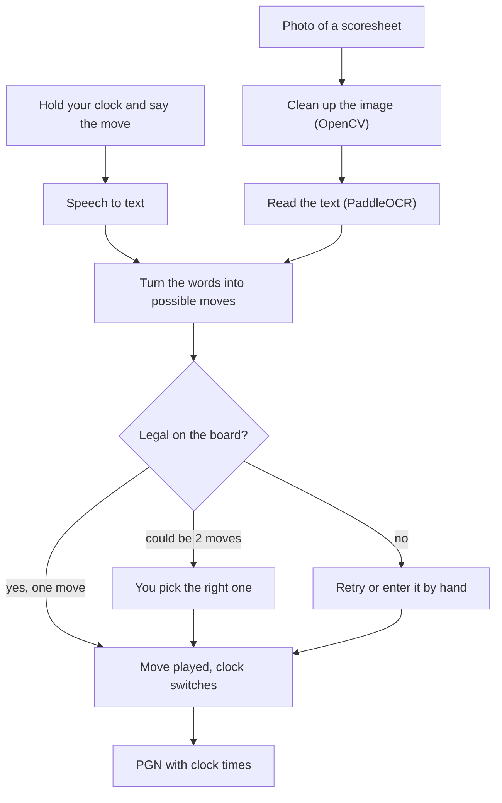

# VoiceMove ♞

**Record · Analyze · Improve**

A chess clock you can talk to. Press and hold your side of the clock, say your move, and it writes the game down for you. When the game's over you get a PGN you can import straight into Lichess or Chess.com.

We're two students building this. It's still a prototype, but the clock + voice part works.

- Website: https://ab-thecoder.github.io/Voice_move/
- Try the clock in your browser: https://ab-thecoder.github.io/Voice_move/Voice_Move.html


## The Great Spark

Chess is a very analytical, ever-learning game. To get better you have to look back at your games and learn from your mistakes.

While analysing a friendly game, we realised how much it sucked to type every move from the paper scoresheet into the analysis board. You write the moves down during the game, type them all again afterwards, and only then can you actually look at the game. It's slow and irritating.

**And that was that.**

## The Dream

Put that whole process in the bin. Instead:

- say your move out loud when you hit your clock
- or take a photo of your paper scoresheet
- and get the game in digital form, ready to analyse

## What's built so far

### 1. The app (Flutter): `flutter_projects/vccn_app`

This is the main part. VCCN stands for Voice-Controlled Chess Notation. It's a two-player chess clock where you:

- tap your side to switch the clock, like a normal clock
- **hold** your side and say your move ("knight f3", "e takes d5", "castles kingside")

The app then turns what you said into a move and checks it's legal on the board (using `dartchess`). If what you said could mean two different moves, it asks which one you meant.

Other stuff it does:

- if it didn't catch your move you can retry, or pick it on a board by tapping the piece and then the square
- undo for the last move
- time controls from 1 min to 30 min, including increment ones (2|1, 3|2, 5|3, 15|10), plus pause
- detects the end of the game: checkmate, stalemate, insufficient material, the 50-move rule and threefold repetition
- share the game as a PGN with the clock time for every move

It uses the phone's own speech recognition (`speech_to_text` package). We tried running Whisper-tiny inside the app first, but the speed and accuracy weren't good enough, so we switched back.

### 2. The website: `docs/`

- The landing page in the screenshot above.
- **Glimpse**, a browser version of the clock. Tap to switch, hold to say a move, add moves on a mini board, and copy the PGN. Voice uses the browser's speech recognition, so it works in Chrome, Edge and Safari but not Firefox. You can upload a scoresheet photo, but it doesn't read it yet.

### 3. The Python prototypes: `App/backend/current/`

This is where we worked out the hard parts before putting them in the app. These scripts run on their own and aren't connected to the app or website yet.

- `Voice_MOve.py` records from your mic, transcribes it with OpenAI Whisper, cleans the text up into a move, checks it with `python-chess` and saves the game as a PGN. If it can't understand you, you type the move instead.
- `paddle2x.py` reads a photo of a scoresheet. It cleans the image up with OpenCV first (grayscale, upscale, straighten, contrast) and then reads it with PaddleOCR. There are sample scoresheets in `App/Data/images/`.
- `clock.py` is a basic chess clock in the terminal (space to switch, `p` to pause, `r` to resume, `Esc` to quit).

## How it works



## Where we're at

| Part | Status |
|---|---|
| Chess clock | Done |
| Voice notation | Done (app and website) |
| Scoresheet OCR | Works in the Python prototype, not in the app yet |
| Engine analysis | In progress |
| Connecting the app to the Python backend (FastAPI) | Planned |
| A system for chess academies, so coaches can follow their students' games | The long-term idea |

Things that aren't there yet:

- There's no APK yet, so for now you have to build the app yourself (steps below).
- The website can't read scoresheets yet.
- Handwritten scoresheets are the hardest part, and OCR only lives in the Python prototype for now.
- Voice can still mishear a move sometimes. That's why there's the "which move did you mean" screen, retry and undo.

## Running it

### Website

Just open the links at the top. To run it locally:

```bash
git clone https://github.com/AB-TheCoder/Voice_move.git
cd Voice_move/docs
python -m http.server 8000
```

Then go to http://localhost:8000.

### The app

You need Flutter installed first (Dart comes with it).

1. Download the Flutter SDK from https://docs.flutter.dev/get-started/install for your OS.
2. Add Flutter to your PATH.
   - macOS/Linux, e.g. if you put it in `~/development/flutter`:
     ```bash
     export PATH="$PATH:$HOME/development/flutter/bin"
     ```
     Put that line in your `~/.zshrc` or `~/.bashrc` so it stays.
   - Windows: add the full path to the `flutter\bin` folder to your System Environment Variables under "Path".
3. Run `flutter doctor`. It tells you if anything else is missing, like Android Studio, Xcode or a device/emulator.

Then:

```bash
git clone https://github.com/AB-TheCoder/Voice_move.git
cd Voice_move/flutter_projects/vccn_app
flutter pub get
flutter run
```

If more than one device is available, `flutter run` asks you which one to use.

<details>
<summary>Running it as a macOS desktop app</summary>

This is how we test it and demo it on a Mac without a phone.

```bash
flutter config --enable-macos-desktop    # one-time setup
flutter create --platforms=macos .       # only if the macos folder is missing
flutter run -d macos
```

Or build it once and just open the app after that:

```bash
flutter build macos --debug
open build/macos/Build/Products/Debug/vccn_app.app
```

The mic needs the usage descriptions in `macos/Runner/Info.plist` and the audio-input entitlement in the Runner entitlements files. Without them the permission popup never shows up and voice won't work. Both are already set up in this repo.

</details>

Tip: say moves the way you'd read them in notation, like "bishop c4", "queen takes h7", "e8 queen" or "castles queenside".

### The Python prototypes

Use Python 3.11 or 3.12, because the ML libraries don't support the newest Python yet. You also need [FFmpeg](https://ffmpeg.org/download.html) on your PATH for Whisper.

```bash
python -m venv .venv
# Windows: .venv\Scripts\activate    macOS/Linux: source .venv/bin/activate
pip install openai-whisper python-chess sounddevice scipy numpy pynput
pip install opencv-python paddlepaddle "paddleocr==2.7.3"
```

Voice move logger (press Enter, say a move, repeat, then type `stop` to save `game.pgn`):

```bash
python App/backend/current/Voice_MOve.py
```

Scoresheet OCR: change the image path at the bottom of `paddle2x.py` to one of the samples (e.g. `App/Data/images/ti5.jpeg`), then:

```bash
python App/backend/current/paddle2x.py
```

## Folder structure

```
docs/                        website (GitHub Pages)
flutter_projects/vccn_app/   the Flutter app (lib/main.dart is most of it)
App/backend/current/         Python voice, OCR and clock prototypes
App/backend/olderversion/    older OCR and API experiments
App/Data/                    sample scoresheet photos and test audio
App/Read_me-APP.md           our plan for the Android app
Voice-Move Python/           early experiments
screenshots/                 images for this README
```

## Who made it

This project is the result of the hard work, dreams and aspirations of both its creators:

- **Aarav Bhatt** ([@AB-TheCoder](https://github.com/AB-TheCoder)): Python backend and prototypes
- **Vihaan Vasudeva**: the app's GUI

We set ourselves a goal of getting a basic version of the whole platform done in 2 months. Day and night were sacrificed for it.

<details>
<summary>Our team rules</summary>

Any disputes between us would hurt the project, so we agreed on these:

- The project is a collective enterprise.
- Every decision is taken together, and everything gets discussed.
- Money matters are split equally, or in some cases however we both agree.
- Never edit someone else's code without telling them.
- Pull the latest code before starting work.
- Test before pushing.
- Write clear commit messages (not "fixed stuff").
- Work is divided to prevent chaos.
- Tasks get finished within the time limit.
- One person owns the project on GitHub and is the only one who changes main. The other works on their own branch and requests changes. The owner only uses this power after we've discussed and agreed.
- The project matters more than anyone's ego.

</details>

## AI use

Being honest about where we used AI:

- The app's UI (colours, layout, animations) was designed and iterated with help from Claude.
- The old FastAPI stub (`App/backend/olderversion/Api.py`) was generated by Gemini.
- The Android plan in `App/Read_me-APP.md` was made with AI help.
- This README was written with Claude's help, based on our old README and our code.

## Contact

Questions, feedback or ideas: bhattaarav2011@gmail.com
