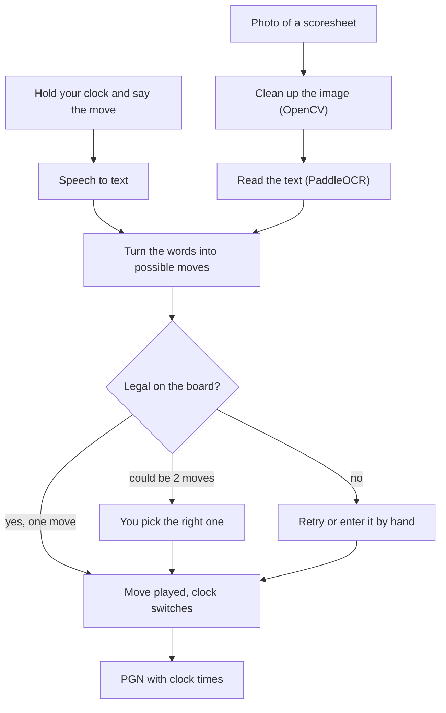

# VoiceMove ♞

**Record · Analyze · Improve**

VoiceMove is basically a chess clock you can talk to. You hold your side of the clock, say your move, and it writes it down for you. At the end of the game you get a PGN that you can paste into Lichess or Chess.com and analyse.

Me and my friend Vihaan are building this together. It's still a prototype, but the clock and voice part already works.

- **Website:** https://ab-thecoder.github.io/Voice_move/
- **Try the clock in your browser:** https://ab-thecoder.github.io/Voice_move/Voice_Move.html


## The Great Spark

Chess is a very analytical and ever-learning game. If you want to get better, you have to go back through your games and see where you went wrong.

One day we were analysing a friendly game we had played, and typing every single move from the paper scoresheet into the analysis board was really annoying. You've already written all the moves down during the game, and now you have to type them all again before you can even start looking at it.

**And that was that.**

## The Dream

Put that whole process in the bin. You should be able to just say your move when you hit the clock, or take a photo of your scoresheet, and have the game ready to analyse straight away.

## What We Have Right Now

### 1. The App (Flutter): `flutter_projects/vccn_app`

This is the main part of the project. VCCN stands for Voice-Controlled Chess Notation.

It works like a normal two-player chess clock: you tap your side to switch. But if you **hold** your side, you can say your move, like "knight f3", "e takes d5" or "castles kingside". The app works out which move you meant and checks that it's actually legal (we use `dartchess` for this). If what you said could mean two different moves, it asks you which one.

If it doesn't catch your move, you can try again or just pick it on a small board by tapping the piece and then the square. There's also an undo button for the last move. At first we made you confirm every single move, but that got annoying really fast, so we replaced it with undo.

It also has:

- time controls from 1 min to 30 min, including increment ones like 2|1, 3|2, 5|3 and 15|10
- a pause button
- automatic game-end detection (checkmate, stalemate, insufficient material, the 50-move rule and threefold repetition)
- PGN sharing, with the clock time saved for every move

For the voice part, it uses the phone's own speech recognition (the `speech_to_text` package). We first tried running Whisper-tiny inside the app, but it was too slow and not accurate enough, so we switched back.

### 2. The Website: `docs/`

The landing page is the one in the screenshot above. There's also **Glimpse**, which is the clock running in your browser. You can tap to switch, hold to say a move, add moves on a mini board and copy the PGN.

Voice only works in Chrome, Edge and Safari, because Firefox doesn't support speech recognition. You can upload a scoresheet photo too, but it can't read it yet.

### 3. The Python Prototypes: `App/backend/current/`

This is where I tested the hard parts before putting them into the app. These scripts run on their own and aren't connected to the app or the website yet.

- **`Voice_MOve.py`** records from your mic and uses Whisper to turn it into text. It then cleans the text up into a move, checks it with `python-chess` and saves the game as a PGN. If it can't understand you, you can just type the move.
- **`paddle2x.py`** reads a photo of a scoresheet. It cleans up the image with OpenCV first (grayscale, upscaling, straightening and contrast) and then reads it with PaddleOCR. There are sample scoresheets in `App/Data/images/`.
- **`clock.py`** is a simple chess clock in the terminal. Space switches the clock, `p` pauses, `r` resumes and `Esc` quits.

## How It Works



## Where We're At

| Part | Status |
|---|---|
| Chess clock | Done |
| Voice notation | Done (app and website) |
| Scoresheet OCR | Works in Python, not in the app yet |
| Engine analysis | Working on it |
| Connecting the app to the Python backend (FastAPI) | Planned |
| A system for chess academies, so coaches can follow their students' games | Long-term idea |

### What's not there yet

- There's no APK yet, so for now you have to build the app yourself (steps below).
- The website can't read scoresheets yet.
- Handwritten scoresheets are honestly the hardest part, and OCR only works in Python right now.
- Voice still gets a move wrong sometimes, which is why the retry and undo options exist.

## Running It

### Website

Just open the links at the top. If you want to run it locally:

```bash
git clone https://github.com/AB-TheCoder/Voice_move.git
cd Voice_move/docs
python -m http.server 8000
```

Then open http://localhost:8000.

### The App

You need Flutter first (Dart comes with it).

1. Download the Flutter SDK from https://docs.flutter.dev/get-started/install.
2. Add it to your PATH.
   - Mac/Linux (if you put it in `~/development/flutter`):
     ```bash
     export PATH="$PATH:$HOME/development/flutter/bin"
     ```
     Put that line in `~/.zshrc` or `~/.bashrc` so it stays.
   - Windows: add the path to the `flutter\bin` folder in System Environment Variables under "Path".
3. Run `flutter doctor`. It'll tell you if you're missing anything (Android Studio, Xcode, a device, etc.).

Then:

```bash
git clone https://github.com/AB-TheCoder/Voice_move.git
cd Voice_move/flutter_projects/vccn_app
flutter pub get
flutter run
```

If you have more than one device, it'll ask which one to use.

<details>
<summary>Running it on a Mac</summary>

This is how we test and demo it without a phone.

```bash
flutter config --enable-macos-desktop    # only once
flutter create --platforms=macos .       # only if the macos folder is missing
flutter run -d macos
```

Or build it once and just open the app after that:

```bash
flutter build macos --debug
open build/macos/Build/Products/Debug/vccn_app.app
```

The mic needs the usage descriptions in `macos/Runner/Info.plist` and the audio-input entitlement in the Runner entitlements files. Otherwise the permission popup never shows up and voice just doesn't work. Both are already in the repo.

</details>

**Tip:** say the move the way you'd read it in notation, e.g. "bishop c4", "queen takes h7", "e8 queen" or "castles queenside".

### Python Prototypes

Use Python 3.11 or 3.12, because the ML libraries don't work on the newest Python yet. You also need [FFmpeg](https://ffmpeg.org/download.html) for Whisper.

```bash
python -m venv .venv
# Windows: .venv\Scripts\activate    Mac/Linux: source .venv/bin/activate
pip install openai-whisper python-chess sounddevice scipy numpy pynput
pip install opencv-python paddlepaddle "paddleocr==2.7.3"
```

Voice move logger (press Enter, say a move, repeat, then type `stop` to save `game.pgn`):

```bash
python App/backend/current/Voice_MOve.py
```

For the OCR, change the image path at the bottom of `paddle2x.py` to one of the samples (like `App/Data/images/ti5.jpeg`) and run:

```bash
python App/backend/current/paddle2x.py
```

## Folder Structure

```
docs/                        website (GitHub Pages)
flutter_projects/vccn_app/   the app (lib/main.dart is most of it)
App/backend/current/         Python voice, OCR and clock
App/backend/olderversion/    older OCR and API experiments
App/Data/                    sample scoresheets and test audio
App/Read_me-APP.md           our plan for the Android app
Voice-Move Python/           early experiments
screenshots/                 images for this README
```

## Who Made It

- **Aarav Bhatt** ([@AB-TheCoder](https://github.com/AB-TheCoder)): Python backend
- **Vihaan Vasudeva**: app GUI

We gave ourselves 2 months to get a basic version of the whole thing done. Day and night will be sacrificed for it.

<details>
<summary>Our team rules</summary>

Any argument between us would mess up the project, so we made a few rules:

- The project is a collective enterprise.
- Decisions are taken together, and everything gets discussed.
- Money is split equally, or however we both agree.
- Never edit someone else's code without telling them.
- Pull the latest code before you start working.
- Test before pushing.
- Write proper commit messages (not "fixed stuff").
- Work is divided so there's no chaos.
- Finish tasks on time.
- One of us owns the repo and is the only one who changes main. The other works on his own branch and asks for changes. The owner can only do this after we've discussed it.
- The project matters more than anyone's ego.

</details>

## AI Use

- The app's UI (colours, layout and animations) was designed and iterated with Claude.
- The old FastAPI stub (`App/backend/olderversion/Api.py`) was made by Gemini.
- The Android plan in `App/Read_me-APP.md` was made with AI help.
- I used Claude to help write this README from our old one and the code.

## Contact

Questions or ideas? Email me at bhattaarav2011@gmail.com.
